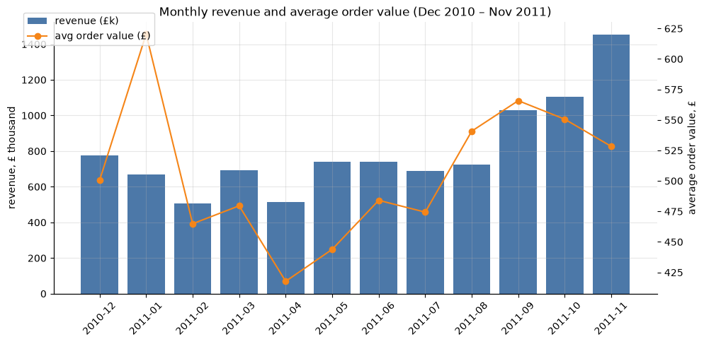
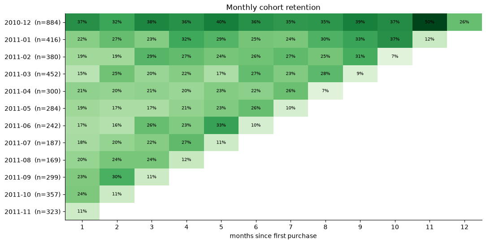
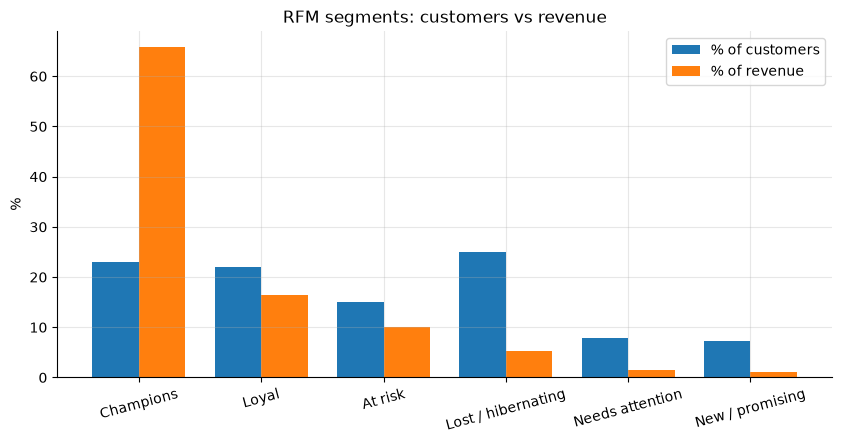
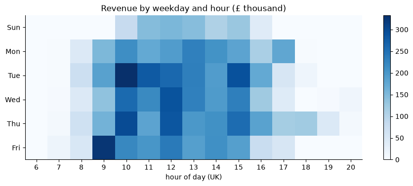
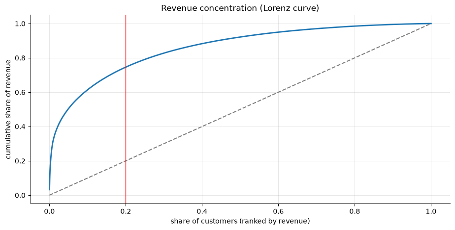

# E-commerce Sales Analysis with SQL

This analysis covers a full year of transactions (541,909 invoice lines) from an online gift and home-ware retailer.
All of it is done in **SQL** (SQLite with CTEs, window functions, `NTILE`, `LAG` and `FIRST_VALUE`), with Python only
for loading the data and drawing charts.

**→ [Open the notebook](analysis.ipynb)** (it renders on GitHub with every query and result)



## Questions answered
- **Data quality:** which lines are missing customers, cancelled, duplicated or not products, and which cleaning rules handle them
- **Revenue:** monthly trend, month-on-month growth, average order value
- **Products & countries:** where revenue comes from, gross vs net of cancellations
- **Timing:** revenue by weekday × hour
- **Customer concentration:** Pareto / Lorenz curve
- **Retention:** monthly cohort analysis
- **Segmentation:** RFM scoring and the action to take for each segment
- **Cancellations:** rate by country and by product, and the order-entry errors behind them

## Key findings
- **Two order-entry errors** (80,995 and 74,215 units, each cancelled within about 20 minutes) put two products into the gross top-6
  and doubled the cancellation rate (4.7% vs a true **2.3%**). Ranking on net revenue fixes this.
- **Seasonal growth came from volume, not basket size.** Revenue doubled from about £0.7m a month to £1.45m in November,
  while average order value stayed at about £420–620.
- **Revenue is concentrated.** The UK is 85% of revenue. The top 1% of customers bring 32% of revenue, and the top 20% bring 75%.
- **Retention is the lever.** 87% of the first cohort became repeat buyers, against 60% of customers acquired later.
- **RFM:** Champions are 23% of customers and 66% of revenue. At-risk customers (15%, about 10% of revenue) are the cheapest revenue to win back.

| Cohort retention | RFM segments |
|---|---|
|  |  |
| **Revenue by weekday × hour** | **Customer concentration** |
|  |  |

## Example query: RFM scoring with window functions
```sql
WITH c AS (
  SELECT CustomerID,
         JULIANDAY(:ref_date) - JULIANDAY(MAX(InvoiceDate)) AS recency_days,
         COUNT(DISTINCT InvoiceNo) AS frequency,
         SUM(revenue)              AS monetary
  FROM sales WHERE CustomerID IS NOT NULL GROUP BY CustomerID
)
SELECT *, NTILE(5) OVER (ORDER BY recency_days DESC) AS R,
          NTILE(5) OVER (ORDER BY frequency)        AS F,
          NTILE(5) OVER (ORDER BY monetary)         AS M
FROM c;
```

## Run it
```bash
pip install -r requirements.txt
jupyter notebook analysis.ipynb
```
The dataset downloads automatically on the first run and is cached in `data/` (git-ignored).

**Data:** Daqing Chen, *Online Retail* (2015), UCI Machine Learning Repository, https://doi.org/10.24432/C5BW33, licensed CC BY 4.0.
